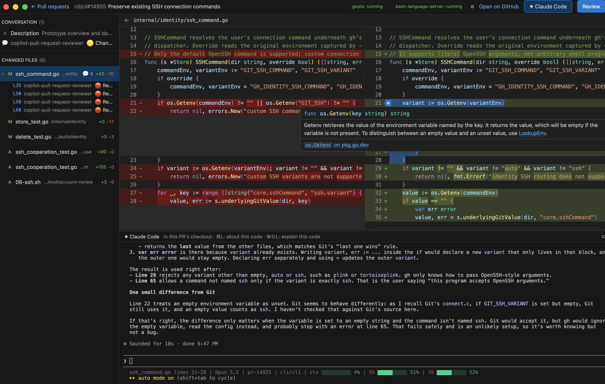

# prr

prr (pronounced "purr") is a macOS app for reviewing GitHub pull requests with real code
intelligence. It checks out the PR, runs each language's own server against it (gopls, clangd,
pyright, starpls, bash-language-server), and shows a side-by-side diff of the whole file: hover
for types and docs, go to definition, peek, find references. Comments, replies and reviews go straight to
GitHub, and a coding agent (Claude Code by default) sits in a panel below the code, ready to
answer questions about what you've selected.



*Reviewing a Go PR: the diff with hover docs from gopls (top), and Claude Code explaining the
selected lines (bottom, ⌘L).*

It's a single native Rust binary with a GPU-rendered UI built on [GPUI](https://www.gpui.rs) and
[GPUI Kit](https://github.com/longbridge/gpui-component). The Python and shell language servers
run on Node.js and ship inside the app.

## Install

Requirements: macOS 11 or later (Apple Silicon or Intel), [Homebrew](https://brew.sh), and the
Xcode Command Line Tools (`xcode-select --install`) for git and clangd.

```sh
brew tap ozkar99/prr https://github.com/ozkar99/prr
brew trust --cask ozkar99/prr/prr   # Homebrew asks before using a third-party tap
brew install --cask prr
gh auth login                       # once: the app uses gh's GitHub login
```

This puts **prr** in Applications and the `prr` command on your `PATH`, and
installs the GitHub CLI (`gh`) and Node.js if you don't have them.

### GitHub access

prr has no login of its own and holds no token: everything it asks GitHub (pull requests, files,
comments, reviews) goes through the [GitHub CLI](https://cli.github.com) as `gh api …`, run exactly
as if you typed it in a terminal:

- through your login shell, so if your company wraps `gh` in a shell function or alias (to set a
  company token, say), prr uses the wrapper too;
- inside a clone of the PR's repo, as if you had `cd`'d into it, so whatever sets up `gh` there
  (direnv, mise, per-repo company settings) applies too. That's the clone you run `prr` in, which
  prr remembers for that repo; for anything else it uses the clone you used last.

If `gh api user` works in your terminal inside the repo, prr works. A clone whose remote is an
internal git host counts as a clone of the PR's repo when the remote ends in the repo's name
(`git@git.corp.internal:repo.git`). If the remote doesn't say which GitHub organization it is, run
`prr` with the PR's full link once from that clone; after that, `prr <number>` works there;
if that host doesn't have GitHub's pull request refs, prr fetches the PR from GitHub. prr's own
checkouts (for PRs you open outside a clone) download over HTTPS with your git credentials, or
through gh if git has none.

### Language servers

Syntax highlighting works without them; they add hover, navigation and references. Install the
ones for the languages you review:

| Language | Files | Server | Install |
|---|---|---|---|
| Go | `.go` | gopls | `brew install go`, then `go install golang.org/x/tools/gopls@latest` |
| C/C++ | `.c` `.cc` `.cpp` `.h` `.hpp` … | clangd | comes with the Xcode Command Line Tools (Homebrew's `llvm` is used if installed) |
| Python | `.py` `.pyi` | pyright | nothing: included |
| Rust | `.rs` | rust-analyzer | `rustup component add rust-analyzer` |
| Shell | `.sh` `.bash` `.zsh` `.ksh`, `.bashrc`, `.zshrc`, … | bash-language-server | nothing: included |
| Starlark / Bazel | `BUILD` `.bazel` `.bzl` `WORKSPACE` `MODULE.bazel` | starpls | from [starpls releases](https://github.com/withered-magic/starpls/releases), on your `PATH` |

The home screen checks for everything the app uses and shows the install command for anything
missing. In a PR, each server's state shows in the header; hover a **not installed** or
**failed** chip for details.

## Supported languages

| Language | Files | Syntax colors | Code intelligence (hover, definition, references) |
|---|---|---|---|
| Go | `.go` | ✓ | ✓ gopls |
| C / C++ | `.c` `.h` `.cc` `.cpp` `.cxx` `.hpp` `.hh` `.ipp` `.inl` `.m` `.mm` | ✓ | ✓ clangd |
| Python | `.py` `.pyi` | ✓ | ✓ pyright (included) |
| Rust | `.rs` | ✓ | ✓ rust-analyzer |
| Shell | `.sh` `.bash` `.zsh` `.ksh`, `.bashrc` `.zshrc` `.profile` … | ✓ | ✓ bash-language-server (included) |
| Starlark / Bazel | `BUILD` `WORKSPACE` `MODULE.bazel` `.bzl` `.bazel` `.star` | ✓ | ✓ starpls |
| Markdown | `.md` `.markdown` | ✓ (code blocks in their own language) | — |

Any other file shows as a plain diff, and you can still comment on it and review it as usual. Go,
C/C++, Rust and Starlark need their server installed ([see Language servers](#language-servers)); the Python and
shell servers come with the app. You can add more languages yourself
([below](#adding-your-own-languages)).

### Adding your own languages

Each language is a plug-in behind one interface: which files it handles, how to run its language
server, and how its status shows in the header. Add languages, or adjust the built-in ones, in
`~/Library/Application Support/review-tool/languages.toml`:

```toml
# A new language: hover, go to definition and references from its server.
[[language]]
name = "Zig"
extensions = ["zig"]
command = "zls"

[[language]]
name = "TypeScript"
extensions = ["ts", "tsx"]
command = "typescript-language-server"
args = ["--stdio"]
language_id = "typescript"
install = "npm install -g typescript-language-server typescript"

# Adjust a built-in (go, cpp, python, rust, shell, starlark): only what you set changes.
[[language]]
id = "go"
command = "/opt/tools/gopls"
env = { GOFLAGS = "-mod=mod" }
```

| Key | Meaning |
|---|---|
| `name`, `id` | Display name and identifier (defaults to the name in lowercase). A built-in's `id` adjusts it. |
| `extensions`, `filenames` | Which files it handles (`["rs"]`, `["Justfile"]`). |
| `command`, `args`, `env` | The language server to run, in the PR's checkout. |
| `language_id` | The LSP language id (defaults to the `id`). |
| `initialization_options` | Sent to the server when it starts. |
| `grammar` | Borrow a built-in grammar for syntax colors: `go`, `c`, `cpp`, `python`, `rust`, `bash` or `markdown`. Without one, added languages show without colors. |
| `install` | Shown in the header and the setup check when the server isn't installed. |

Changes apply to PRs you open afterwards. Mistakes in the file show in the home screen's setup check.

## Opening PRs

```sh
prr https://github.com/owner/repo/pull/123   # a PR URL
prr owner/repo#123                           # a PR reference
prr 123                                      # inside a clone: PR #123 of that repo
prr                                          # inside a clone: the PR for your current branch
prr --version                                # the installed version (-v); --help for usage
```

Or open the app and pick a PR from **Review requested** / **Your pull requests**, or paste a URL
or `owner/repo#123`.

Each PR gets its own window, so you can review several at once. Opening a PR that's already open
brings its window forward; a window on the home screen is reused. Each window has its own
language servers, agent and back stack, and closing it (**⌘W**) cleans up just that PR. **⌘N**
opens a new window, **⌘`** switches windows, and the app quits with its last window.

### Where the code comes from

- **Inside your own clone of the PR's repo**, `prr` reviews the PR right there: no second
  copy, and your language-server caches are reused. The window goes straight to the PR (no
  questions, and the home screen's PR lists aren't loaded). If the clone isn't already at the PR,
  it switches it to a branch of its own, `prr/pr-<number>`, at the PR's head (never a
  detached HEAD, and never your branches). When you close the PR it switches back to the branch
  you were on, if the clone is still on `prr/pr-<number>` with no uncommitted changes. The PR
  branch stays, with anything you committed on it; if it has commits of yours, a later review of
  that PR uses `prr/pr-<number>-<commit>` instead of touching them. It never switches a clone with
  uncommitted changes: then the PR opens in a copy-on-write copy of the clone (below) instead.
- **More PRs from the same clone** (another window is using it), or a clone with uncommitted
  changes: the PR gets a `git worktree` of your clone whose files are copy-on-write copies of your
  checkout. It shares the clone's objects and only costs disk for the files that differ, so
  several PRs of a large monorepo stay cheap. It shows in `git worktree list` while the window is
  open and is removed when you close it.
- **Anywhere else**, the app uses its own copy: a blobless clone per repo (history without file
  contents, so even a big repo's first PR opens quickly) and a checkout per PR.

The app's own copies live in `~/Library/Application Support/review-tool/`. Checkouts you haven't
opened for 14 days are removed automatically, and the **Storage** section of the home screen
shows their size with buttons to clear them. Your own clones are never touched by cleanup.

## Reading the code

- Files open as a side-by-side diff of the **whole file**, at the first change. New and deleted
  files have nothing to compare, so they show as a single column (marked *new file* or *deleted in
  this PR*).
- **⌘F** finds text in the open file (the new side of a diff): matches are highlighted, **Enter** /
  **⇧Enter** (or ↓ / ↑) move between them, **Esc** closes.
- **Hover** a symbol for its type and docs.
- **⌘-click** or **F12**: go to definition. A file the PR changes opens as a diff; any other file
  opens read-only, marked *not changed in this PR*.
- **⌥F12** peeks at the definition and **⇧F12** finds references: a preview of the code beside the
  results, grouped by file. Click to preview, double-click or **Enter** to open, **↑/↓** to move,
  **Esc** to close.
- **Ctrl+-**, the mouse back button, or **←** above the code: go back.
- Drag the sidebar's edge, or the divider between the old and new sides of the diff, to resize
  them; the app remembers both.

## Reviewing

The sidebar has two sections:

- **Conversation**: the PR description, general comments, and review summaries (✓ approved,
  ± changes requested). The bottom of that page has a box for a general comment, which posts
  right away.
- **Changed files**: each file with its comment threads underneath (line, author, first line).
  Click a thread to jump to it.

In the diff:

- **Add a comment**: hover a line and click the blue **+** in the gutter, press **⌘⌥C**, or
  right-click → **Add Review Comment**. Select several lines first to comment on a range. Only lines
  inside the diff can take comments (a GitHub rule).
- **⌘↩** submits a comment; **Esc** cancels.
- Threads show under their line: reply, resolve or unresolve, and delete your pending comments.
  Threads whose code has since changed are under **Show N outdated threads** above the code.

Comments and replies go into your **pending review**, which only you can see until you submit
it. Click **Finish review** (top right), add an optional summary, and choose **Comment**,
**Approve** or **Request changes**.

## Asking an agent about the code

**⌘J** (or **✦ Claude Code** in the header) opens a terminal panel below the code with a coding
agent running in the PR's checkout: Claude Code by default, using your Claude Code login. It
starts the first time you open the panel and keeps running while the panel is hidden.

Select some lines (or just click one), then use a shortcut or the **Agent** items at the top of
the code's right-click menu:

| Command | Shortcut | What happens |
|---|---|---|
| **Agent: Explain this code** | ⌘⇧L | Sends `Explain <file> lines A-B.` right away. |
| **Agent: About this code** | ⌘L | Types `About <file> lines A-B: ` into the agent; you finish the question. |

Lines from the left side of a diff are marked as the old version. If the agent is still
starting, the text is typed once it's ready. It's never typed into a question the agent is asking;
answer that yourself first. Claude Code asks "trust this folder?" once per repository; to skip it,
turn on **Trust PR checkouts in Claude Code** in Settings.

The panel is a full terminal: **⌘C** / **⌘V** copy and paste, **⌘K** clears, scroll for history,
**⌘-click** opens a link. Drag the divider to resize. **Restart** appears if the agent exits.
While you type in the panel, keys like **⌘L** and **Ctrl+-** go to the agent, not the app.

### Reviewing through the agent

You can ask the agent to act on the review: *"leave a comment on line 42 saying …"*, *"reply to
that thread"*, *"resolve the nil-check thread"*, *"approve this PR"*, *"request changes, the error
handling needs tests"*. Each action pops up in the PR's window showing exactly what will be posted,
and happens only if you click to confirm; **Don't** tells the agent you declined. (GitHub has no
"reject": that's **Request changes**.) Comments and replies go into your pending review, like the
ones you write yourself.

### What the agent can see and do

The app gives the agent an MCP server, one per window, so an agent only sees its own window's PR:

| Tools | What for |
|---|---|
| `get_selection`, `get_pr`, `get_file_diff` | What you're looking at, the PR's description and files, one file's diff |
| `git_log`, `git_blame`, `git_show` | History, read-only |
| `get_review_threads` | The review threads, with the ids the actions below need |
| `add_review_comment`, `reply_to_thread`, `resolve_thread`, `add_pr_comment`, `submit_review` | Acting on the review; each one is confirmed by you in the app |

Claude Code in the panel is **read-only**: it can read and search the checkout and use these tools,
but it has no shell, no editing tools and no web access, so it can't change files or send code
anywhere. The PR can't configure it either: the repo's `.mcp.json` and `.claude/settings.json`
(hooks, permissions) are ignored. It also runs as its own session when you start `prr`
from inside Claude Code.

### Using another agent

Open **Settings** and enter a command under **Agent command** (for example `codex`). It runs
through your login shell in the PR's checkout, the next time the agent starts. Clear it to go back
to Claude Code.

Every agent gets these environment variables:

| Variable | Contents |
|---|---|
| `REVIEW_TOOL_MCP_STDIO` | A stdio MCP server command (no arguments) that connects to the app; for agents that only run stdio MCP servers |
| `REVIEW_TOOL_MCP_URL`, `REVIEW_TOOL_MCP_TOKEN` | The HTTP MCP endpoint and its bearer token |
| `REVIEW_TOOL_MCP_CONFIG` | `{"mcpServers": {...}}` JSON for the HTTP endpoint, the shape Claude Code's `--mcp-config` takes |
| `REVIEW_TOOL_SELECTION_FILE` | A JSON file with the PR and the current selection, kept up to date; for agents without MCP |
| `REVIEW_TOOL_INSTRUCTIONS` | A paragraph explaining the review setup, to pass as a system prompt or first message |
| `REVIEW_TOOL_PR`, `REVIEW_TOOL_ROOT`, `REVIEW_TOOL_MERGE_BASE` | `owner/repo#N ("title")`, the checkout path, and the diff's base commit |

For example (check the agent's docs for the exact flags):

```sh
# Codex, with the review-tool MCP server over stdio
codex -c "mcp_servers.review_tool.command=\"$REVIEW_TOOL_MCP_STDIO\""

# Claude Code with a different model, keeping the app's context
claude --model sonnet --mcp-config "$REVIEW_TOOL_MCP_CONFIG" --strict-mcp-config --setting-sources user --append-system-prompt "$REVIEW_TOOL_INSTRUCTIONS"
```

A custom command runs with that agent's usual permissions and project settings: the read-only
setup above applies to the built-in Claude Code. Review actions through the MCP tools still need
your confirmation in the app, whatever the agent.

## Settings

**⌘,** (also **prr → Settings…**, **Settings** on the home screen, or **⚙** in a PR):

- **Agent command**: empty for Claude Code, or another agent's command.
- **Trust PR checkouts in Claude Code** (off by default): skips Claude Code's "trust this folder?"
  for the agent panel by marking the PR's repository as trusted in `~/.claude.json`.
- **Editor font size** and **terminal font size**, applied right away.

The sidebar's width, the diff's split and the agent panel's height are remembered too. Everything is saved in
`~/Library/Application Support/review-tool/settings.json`.

## Troubleshooting

| Problem | Fix |
|---|---|
| "Couldn't load pull requests" | Run `gh api user` in a terminal inside your clone: prr runs exactly that. Fix it there (`gh auth login`, your company's setup) and click **Check again**. |
| A server chip says **not installed** | Install it (hover the chip for the command), then reopen the PR. |
| A server chip says **failed** | Hover it to see the error. |
| C++ types are wrong or headers don't resolve | clangd needs `compile_commands.json` (below). |
| The agent exited | Its output is in the panel. Check **Agent command** in Settings, then **Restart**. |

### Go in Bazel monorepos

In a Bazel repository (`WORKSPACE`, `WORKSPACE.bazel` or `MODULE.bazel` at the top), gopls would
walk Bazel's output folders (`bazel-bin`, `bazel-out`, … links into a huge cache) and load every
package in the repository before answering anything, which can keep every CPU busy for a long time.
There, prr has gopls skip those folders and load only the folders the PR changes; the header
shows "gopls: running · N folders". Code those folders use still loads when needed, so hover,
Go to Definition and Peek work everywhere; Find All References searches only the PR's folders.

If your repository's Go code only resolves through Bazel, gopls needs Bazel's packages driver.
prr doesn't turn that on by itself, because it runs `bazel`, which runs the build files of the PR
you're reviewing. If you trust the repository, point gopls at its driver script in
`languages.toml`:

```toml
[[language]]
id = "go"
env = { GOPACKAGESDRIVER = "/path/to/monorepo/tools/gopackagesdriver.sh" }
```

### C++ compile flags

clangd uses `compile_commands.json` at the repo root or in `build/`, `out/`,
`cmake-build-debug/` or `builddir/`. Without one it guesses: `-std=c++20` plus `-I` for the repo
root, `include/`, `src/`, `lib/`, `third_party/` and `external/`. That resolves most headers but
can pick the wrong overload. The app doesn't generate the file, because that would mean running
the PR's build system.

## Safety

PR code is untrusted, so the app never builds or runs it:

- Files are only displayed, never modified. Besides the PR's checkout, the app opens a file only
  when you go to a definition in it.
- gopls runs with `GOTOOLCHAIN=local`, so a PR's `go.mod` can't make it download and run another Go
  toolchain.
- rust-analyzer runs with build scripts and proc macros off, on your own toolchain (a PR's
  `rust-toolchain.toml` can't switch it), and ignores rustc wrappers a PR's `.cargo/config.toml`
  sets.
- Comments and descriptions are Markdown drawn by the app itself; nothing in them runs.

## Development

### Building

Needs Rust ([rustup](https://rustup.rs)), and Node.js for the Python and shell language servers.

```sh
git clone git@github.com:ozkar99/prr.git
cd prr
npm install --prefix target/language-servers pyright@1.1.414 bash-language-server@5.8.1   # once
cargo run -- --open-pr=https://github.com/owner/repo/pull/123
```

The first build takes a few minutes. Xcode isn't needed: shaders compile when the app starts.

`scripts/bundle-macos.sh` builds `dist/prr.app`, a DMG, and `dist/prr` (a link to
the app's binary, which is also the command); add `universal` for an Apple Silicon + Intel build,
as releases use.

Development builds run as a separate instance from the installed app. For scripted UI testing,
start one with `REVIEW_TOOL_DEBUG_PORT=<port>` and POST JSON commands to
`http://127.0.0.1:<port>/`: pointer moves, clicks, keys, typing, window screenshots (see
`src/devdriver.rs`). Release builds don't include this.

### Releasing

1. Bump `version` in `Cargo.toml`; commit and push.
2. Tag it: `git tag -a vX.Y.Z -m "prr vX.Y.Z" && git push origin vX.Y.Z`. CI
   (`.github/workflows/release.yml`) builds the universal app and publishes the DMG as a GitHub
   Release. (**Actions → Release → Run workflow** builds without releasing.)
3. In `Casks/prr.rb`, set `version`, and `sha256` to the DMG's checksum
   (`curl -sL <dmg url> | shasum -a 256`); commit and push. Users get it with
   `brew upgrade --cask prr`.

The app is ad-hoc signed, and the cask clears macOS's download quarantine. To sign and notarize
with an Apple Developer ID instead, add these repository secrets (Settings → Secrets and
variables → Actions); the workflow uses them when present:

| Secret | Value |
|---|---|
| `APPLE_CERTIFICATE` | The "Developer ID Application" certificate as a `.p12`, base64-encoded (`base64 -i cert.p12 \| pbcopy`) |
| `APPLE_CERTIFICATE_PASSWORD` | The `.p12` password |
| `APPLE_SIGNING_IDENTITY` | e.g. `Developer ID Application: Your Name (TEAMID)` |
| `APPLE_ID` | The Apple ID email for notarization |
| `APPLE_PASSWORD` | An app-specific password for that Apple ID |
| `APPLE_TEAM_ID` | The 10-character team ID |

### Code map

| Piece | Where |
|---|---|
| `prr` command, single instance, windows | `src/cli.rs`, `src/instance.rs`, `src/windows.rs`, `src/main.rs` |
| Home screen, setup check, storage | `src/home.rs`, `src/backend/deps.rs`, `src/backend/cleanup.rs` |
| GitHub: review queue, PRs, threads, comments, reviews | `src/backend/github.rs` |
| Checkouts: your clone, its copy-on-write worktrees, the app's own clones | `src/backend/git.rs` |
| Side-by-side diff (based on GPUI Kit's, with token hover/click and inline threads) | `src/diffview/` |
| Syntax highlighting (tree-sitter, VS Code Dark Modern colors) | `src/highlight.rs` |
| Language servers: hover, definition, references | `src/lsp.rs` |
| PR window: sidebar, navigation, hover and peek | `src/pr_view.rs` |
| Review threads, comment box, conversation, finish-review panel | `src/review.rs` |
| Agent panel: terminal, agent launch, MCP server | `src/terminal.rs`, `src/backend/agent.rs`, `src/backend/mcp.rs` |
| Settings | `src/settings.rs` |
| Homebrew cask (this repo is also the tap) | `Casks/prr.rb` |
